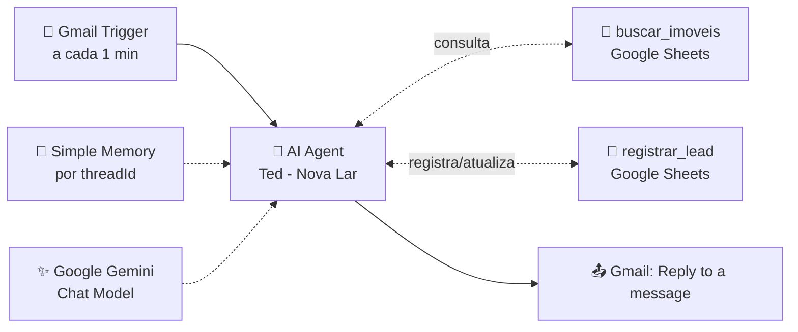

# 🏠 Automação de Atendimento Imobiliário com n8n + IA

> Agente de IA que lê e-mails de clientes interessados em imóveis, consulta um catálogo no Google Sheets, responde automaticamente em HTML e registra os leads em uma planilha, tudo sem intervenção humana.

---

## 📌 Sumário

- [Visão geral](#-visão-geral)
- [Visão do workflow completo](#-visão-do-workflow-completo)
- [Arquitetura](#-arquitetura)
- [Etapas do workflow](#-etapas-do-workflow)
- [Planilhas utilizadas](#-planilhas-utilizadas)
- [Como o prompt do agente foi pensado](#-como-o-prompt-do-agente-foi-pensado)
- [Exemplos de execução](#-exemplos-de-execução)
- [Como rodar o projeto](#-como-rodar-o-projeto)
- [Limitações e próximos passos](#-limitações-e-próximos-passos)
- [Tecnologias](#-tecnologias)
- [Autora](#-autora)

---

## 🎯 Visão geral

Imobiliárias recebem muitos e-mails repetitivos: "tem apartamento de 2 quartos na Zona Sul?", "aceita pet?", "que documentos preciso para alugar?". Responder tudo manualmente é lento, e leads quentes podem esfriar enquanto esperam.

Este projeto simula esse cenário para uma imobiliária fictícia, a **Nova Lar Imóveis** (São Paulo), e automatiza o fluxo inteiro:

1. **Recebe** o e-mail do cliente (Gmail Trigger).
2. **Interpreta** o pedido com um agente de IA (Ted, o assistente virtual da Nova Lar).
3. **Consulta** o catálogo de imóveis em tempo real (Google Sheets).
4. **Responde** na mesma conversa, com recomendações formatadas em HTML.
5. **Registra ou atualiza** o lead em uma planilha de CRM, sem duplicar clientes.

### O que o agente sabe fazer

| Capacidade | Como funciona |
|---|---|
| Recomendar imóveis | Consulta a planilha de catálogo e filtra por modalidade, disponibilidade, pet friendly e mobiliado |
| Explicar processo de compra/aluguel | Etapas e prazos médios definidos no prompt |
| Informar documentação | Lista de documentos para compra e para aluguel |
| Responder dúvidas frequentes | FGTS, negociação de preço, taxa de corretagem, pets |
| Captar leads | Registra interesse real na planilha de leads |
| Encaminhar para visita | Convida o cliente a agendar via WhatsApp |

---

## 🗺️ Visão do workflow completo

<!-- 📸 PRINT: tela inteira do canvas do n8n mostrando todos os nós conectados -->

---

## 🧩 Arquitetura

**Linha contínua** = fluxo principal de execução. **Linha pontilhada** = sub-nós conectados ao agente (modelo, memória e ferramentas), que ele aciona quando precisa.

---

## 🔍 Etapas do workflow

### 1️⃣ Gmail Trigger: captura do e-mail

Monitora a caixa de entrada com *polling* a cada minuto. O modo `simple` está desligado, então o n8n entrega a mensagem completa (corpo, cabeçalhos, `threadId`), e esses dados são usados nas etapas seguintes.

| Configuração | Valor |
|---|---|
| Frequência | A cada minuto |
| Modo simplificado | Desativado (retorna cabeçalhos e corpo completos) |
| Filtros | Nenhum |

<!-- 📸 PRINT: configuração do nó Gmail Trigger (aba Parameters) -->

<!-- 📸 PRINT: saída (output) do nó após receber um e-mail de teste -->

---

### 2️⃣ AI Agent: o cérebro do fluxo

O agente recebe o texto do e-mail (`{{ $json.text }}`) e segue um **system prompt** detalhado que define persona, tom de voz, regras de negócio, quando usar cada ferramenta e o formato da resposta (HTML).

Ele é composto por quatro sub-nós:

| Sub-nó | Tipo | Papel |
|---|---|---|
| **Google Gemini Chat Model** | Modelo de linguagem | Gera as respostas e decide quais ferramentas chamar |
| **Simple Memory** | Memória de janela | Guarda as últimas 30 mensagens, separadas por `threadId` (cada conversa de e-mail tem sua própria memória) |
| **buscar_imoveis** | Ferramenta (Google Sheets) | Lê o catálogo de imóveis |
| **registrar_lead** | Ferramenta (Google Sheets) | Cria ou atualiza leads |

<!-- 📸 PRINT: aba Parameters do AI Agent, mostrando o System Message -->

---

### 3️⃣ Google Gemini Chat Model

Modelo de linguagem que alimenta o agente. É ele quem interpreta o e-mail, decide se precisa consultar o catálogo ou registrar um lead e redige a resposta final.

<!-- 📸 PRINT: configuração do nó Google Gemini Chat Model -->

---

### 4️⃣ Simple Memory: contexto por conversa

Usa o `threadId` do Gmail como chave de sessão. Assim, se o cliente responde o mesmo e-mail dias depois ("gostei do segundo, tem como visitar?"), o agente lembra o que já foi conversado naquela thread, sem misturar com outros clientes.

| Configuração | Valor |
|---|---|
| Tipo de sessão | Chave customizada |
| Session Key | `{{ $json.threadId }}` |
| Janela de contexto | 30 mensagens |

<!-- 📸 PRINT: configuração do nó Simple Memory -->

---

### 5️⃣ buscar_imoveis: catálogo no Google Sheets

Ferramenta que dá ao agente acesso de leitura à planilha de imóveis. O prompt obriga o agente a **sempre** consultá-la antes de recomendar algo, evitando que ele invente imóveis.

<!-- 📸 PRINT: configuração do nó buscar_imoveis -->

<!-- 📸 PRINT: a planilha de catálogo aberta no Google Sheets -->

---

### 6️⃣ registrar_lead: CRM simples no Google Sheets

Ferramenta com operação **Append or Update**, usando o **E-mail como chave de correspondência**. Na prática:

- Cliente **novo** → cria uma nova linha com status "Novo lead".
- Cliente **recorrente** → atualiza a linha existente (novo imóvel de interesse, orçamento, próximo passo), sem duplicar.

Os campos são preenchidos pelo próprio agente a partir da conversa (via `$fromAI`), exceto o e-mail, que vem direto do cabeçalho da mensagem.

<!-- 📸 PRINT: configuração do nó registrar_lead (mapeamento de colunas) -->

<!-- 📸 PRINT: a planilha de leads com algumas linhas preenchidas -->

---

### 7️⃣ Reply to a message: resposta na mesma thread

Envia a resposta gerada pelo agente (`{{ $json.output }}`) como **reply** ao e-mail original, mantendo a conversa encadeada na caixa do cliente.

<!-- 📸 PRINT: configuração do nó Reply to a message -->

---

## 📊 Planilhas utilizadas

### Catálogo de imóveis (`buscar_imoveis`)

| Coluna | Descrição |
|---|---|
| ID | Identificador único do imóvel |
| Tipo | Apartamento, casa, sala comercial, studio |
| Modalidade | Venda ou Aluguel |
| Bairro | Localização |
| Metragem (m²) | Área do imóvel |
| Quartos / Suítes / Vagas | Características |
| Preço (R$) | Valor de venda ou aluguel |
| Condomínio (R$/mês) | Taxa condominial |
| Destaques | Diferenciais do imóvel |
| Pet Friendly | Sim / Não |
| Mobiliado | Sim / Parcial / Não |
| Disponível | Sim / Não (indisponíveis nunca são recomendados) |

### Leads (`registrar_lead`)

| Coluna | Preenchida por |
|---|---|
| Data | Agente (data atual) |
| Nome | Agente (extraído do e-mail) |
| E-mail | Cabeçalho do Gmail (chave de busca) |
| Telefone | Agente ("Não informado" se ausente) |
| Interesse (Compra/Aluguel) | Agente |
| Região de Preferência | Agente |
| Quartos | Agente |
| Orçamento Máximo (R$) | Agente |
| Imóvel de Interesse (ID) | Agente |
| Resumo da Conversa | Agente (1-2 frases) |
| Status | Agente ("Novo lead" ou atualizado) |
| Próximo Passo | Agente (ex.: "Agendar visita") |

---

## 🧠 Como o prompt do agente foi pensado

O system prompt é organizado em blocos, para deixar o comportamento previsível:

| Bloco | Objetivo |
|---|---|
| **Quem você é** | Persona (Ted, assistente da Nova Lar) e contexto do negócio |
| **Tom de voz** | Profissional e acolhedor, direto ao ponto, tratamento por "você" |
| **Informações da empresa** | Regiões, faixas de preço, horários, contatos |
| **Ferramentas** | Quando e como usar `buscar_imoveis` e `registrar_lead` |
| **Regras de leitura da planilha** | Filtrar por modalidade, disponibilidade, pet e mobiliado |
| **Documentação e processos** | Respostas padronizadas para compra e aluguel |
| **FAQ** | Respostas para dúvidas recorrentes |
| **Regras importantes** | Limites: máximo de 3 imóveis por resposta, nunca inventar, recusar assuntos fora do escopo |
| **Formatação** | Resposta sempre em HTML válido, com blocos visuais separados |

### Decisões de design que valem destacar

- **"Nunca responda de memória"**: força a consulta à planilha, evitando alucinação de imóveis.
- **Verificar antes de registrar o lead**: evita linhas duplicadas para o mesmo cliente.
- **Não registrar perguntas genéricas**: mantém a planilha de leads limpa, só com interesse real.
- **Máximo de 3 opções por resposta**: e-mail objetivo, sem sobrecarregar o cliente.
- **Resposta em HTML**: o Gmail renderiza o HTML, permitindo negrito, listas e links clicáveis.

---

## ▶️ Exemplos de execução

### Cenário 1: cliente procurando imóvel para alugar

**E-mail enviado pelo cliente:**
<!-- 📸 PRINT: e--mail enviado pelo cliente e resposta da agente -->

<!-- 📸 PRINT: Mesmo cliente responde na mesma thread, mudando o orçamento. O agente usa a memória da conversa e **atualiza** a linha existente, sem criar uma nova. -->

<!-- 📸 PRINT: resposta do Ted recebida pelo cliente -->

<!-- 📸 PRINT: linha criada na planilha de leads -->

---

### Cenário 2: cliente recorrente (atualização de lead)

Mesmo cliente responde na mesma thread, mudando o orçamento. O agente usa a memória da conversa e **atualiza** a linha existente, sem criar uma nova.

<!-- 📸 PRINT: primerio e-mail do cliente com resposta do Ted -->

<!-- 📸 PRINT: salvando as informações na planilha de leads -->

<!-- 📸 PRINT: segundo e-mail do cliente na mesma thread e a resposta do Ted sugerindo agendamento via WhatsApp  -->

<!-- 📸 PRINT: planilha de leads mostrando a MESMA linha atualizada -->

---

### Cenário 3: pergunta genérica (sem registro de lead)

<!-- 📸 PRINT: resposta do agente e planilha de leads sem nova linha -->

---

### Cenário 4: pedido fora do escopo

Quando o cliente pergunta algo sem relação com imóveis, ou com dados que não correspondem com a empresa em questão, o agente orienta e redireciona para o foco do negócio.

<!-- 📸 PRINT: e-mail fora de escopo + resposta redirecionando -->

---

## 🚀 Como rodar o projeto

### Pré-requisitos

- Instância do [n8n](https://n8n.io/) (cloud ou self-hosted)
- Conta Google com acesso ao Gmail e ao Google Sheets
- Chave de API do [Google Gemini](https://aistudio.google.com/)

### Passo a passo

1. **Importe o workflow**
   No n8n: *Workflows → Import from File* e selecione `Simulação - Automação Imobiliária.json`.

2. **Crie as duas planilhas no Google Sheets**
   - Uma de **catálogo de imóveis**, com as colunas descritas [acima](#catálogo-de-imóveis-buscar_imoveis).
   - Uma de **leads**, com as colunas descritas [acima](#leads-registrar_lead).

3. **Configure as credenciais no n8n**
   - Gmail OAuth2 (nós *Gmail Trigger* e *Reply to a message*)
   - Google Sheets OAuth2 (nós *buscar_imoveis* e *registrar_lead*)
   - Google Gemini (PaLM) API (nó *Google Gemini Chat Model*)

4. **Segurança** 
   As credenciais de Gmail, Google Sheets e Gemini devem ser configuradas individualmente na instância do n8n. Nenhuma chave de API ou credencial é compartilhada neste repositório.

5. **Aponte os nós de planilha para as suas planilhas**
   Nos nós `buscar_imoveis` e `registrar_lead`, selecione o documento e a aba corretos.

6. **Teste**
   Envie um e-mail para a conta Gmail conectada e execute o workflow manualmente (*Test workflow*) ou ative-o (*Active*).

> 💡 Os dados da imobiliária (nome, telefone, regiões, faixas de preço) estão no **System Message** do nó AI Agent. Adapte para o seu caso.

---

## 📈 Resultados obtidos

O workflow foi testado com diferentes cenários de atendimento:

- Busca de imóveis conforme as preferências do cliente.
- Respostas contextualizadas com informações do catálogo.
- Registro de novos leads no Google Sheets.
- Atualização de leads existentes sem duplicação.
- Manutenção do contexto em conversas na mesma thread.
- Identificação de solicitações fora do escopo.

---

## ⚠️ Limitações e próximos passos

Este projeto é uma **simulação desenvolvida para fins de portfólio**. Embora o fluxo execute as funcionalidades propostas, existem melhorias que podem torná-lo mais robusto e adequado para um ambiente de produção.

- [ ] **Filtros no Gmail Trigger:** implementar filtros por remetente, assunto ou marcador para evitar o processamento de mensagens irrelevantes, como newsletters e spam.
- [ ] **Revisão humana:** adicionar uma etapa de aprovação antes do envio de respostas, especialmente em situações que exigem atenção ou validação.
- [ ] **Tratamento de erros:** implementar um fluxo com *Error Trigger* para identificar falhas de execução e notificar os responsáveis.
- [ ] **Normalização do e-mail:** extrair somente o endereço de e-mail do cabeçalho `From`, garantindo maior consistência na identificação e busca de leads.
- [ ] **Agendamento automático:** integrar com o Google Calendar para facilitar o agendamento de visitas a partir das conversas.
- [ ] **Notificações para corretores:** implementar notificações via Slack ou WhatsApp quando um lead com alto potencial for identificado.
- [ ] **Escalonamento para atendimento humano:** identificar reclamações, solicitações complexas ou situações que exijam intervenção humana e encaminhá-las à equipe responsável.

---

## 🛠️ Tecnologias

- **[n8n](https://n8n.io/)**: orquestração do workflow
- **Google Gemini**: modelo de linguagem do agente
- **LangChain (nós nativos do n8n)**: AI Agent, memória e ferramentas
- **Gmail API**: gatilho e envio de respostas
- **Google Sheets API**: catálogo de imóveis e base de leads

---

## 👩‍💻 Autora

**Thaiza**
Estudante de Análise e Desenvolvimento de Sistemas · Desenvolvedora backend (Python/FastAPI)

- GitHub: [github.com/thaiza-dantas](https://github.com/thaiza-dantas)

---

Projeto fictício para fins de estudo e portfólio. "Nova Lar Imóveis", os dados do catálogo e os contatos são exemplos.
